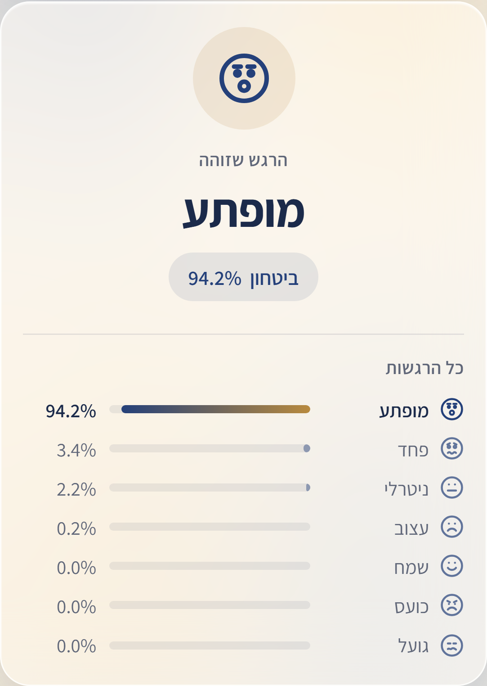
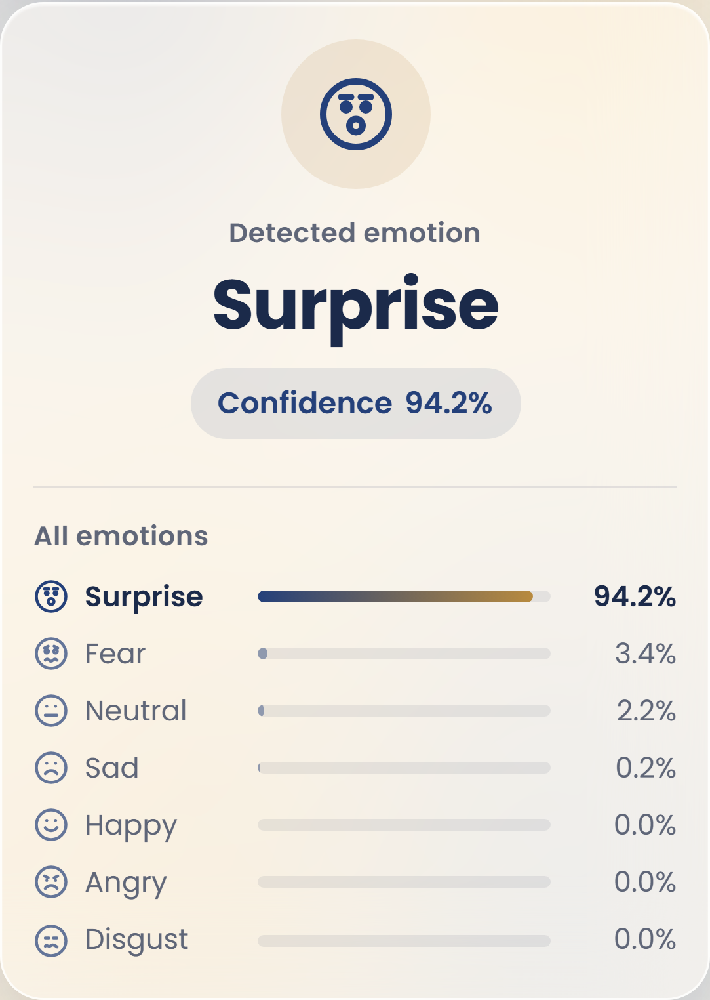

# Project Vision · CNN

Facial-emotion recognition with a convolutional neural network, end to end. The model is trained in Google Colab.
A web app (FastAPI + Streamlit) lets anyone take or upload a photo and see the emotion.

מערכת לזיהוי הבעות פנים בעזרת רשת נוירונים קונבולוציונית (CNN). המודל מאומן ב-Google Colab, ואפליקציית רשת בעברית
ובאנגלית מזהה את הרגש בתמונה, מהמצלמה או מקובץ.

| | |
|---|---|
| **Topic** | Facial expressions: angry, disgust, fear, happy, neutral, sad, surprise |
| **Dataset** | FER+ (FER-2013 faces with Microsoft's improved labels), `contempt` removed → 7 classes |
| **Model** | CNN: 3 × (Conv2D + MaxPooling) → Dense 128 → Dropout 0.5 → Dense 7 softmax · 355,847 parameters |
| **Test accuracy** | **74.5%** on the FER+ test set (7,042 images) |
| **App** | FastAPI REST backend + Streamlit frontend · Hebrew/English · phone and desktop |
| **Bonuses** | Probability of every emotion · "Unknown" below 60% · public access with ngrok · phone screenshots |

<p align="center">
  
  &nbsp;&nbsp;
  
</p>

---

## How it works

```
photo ─▶ face detection ─▶ preprocessing ─▶ CNN ─▶ prior correction ─▶ result
         (OpenCV Haar,      (grayscale,       (v2)    (balance_prediction)  (emotion, confidence,
          crop the face)     48×48, /255,                                    all 7 percentages,
                             reshape 1×48×48×1)                              "Unknown" if < 60%)
```

The preprocessing in the app is the same as in training: grayscale, resize to 48×48, pixel values divided by 255,
and reshape to the model's input `(1, 48, 48, 1)`.

```
Streamlit (app.py)  ──HTTP──▶  FastAPI (api.py)  ──▶  vision_core.py  ──▶  models/training_model_v2.keras
     UI only                    validation +           inference
                                call chain             functions
```

The website never loads the model itself. It sends the image to the API over HTTP, and the API loads the model
once, at startup.

## The model

Training (in `PROJECT_CNN.ipynb`): `ImageDataGenerator` with rescale 1/255 and augmentation (shear, zoom,
horizontal flip), `flow_from_directory` (48×48, grayscale, batch 32), Adam optimizer, categorical cross-entropy,
EarlyStopping on validation loss (patience 5, best weights restored).

### Experiments

All three models share the same architecture. Only the training data and settings changed.

| Model | Trained on | Test accuracy | |
|---|---|---|---|
| v1 | FER-2013 | ~59% | first version |
| **v2** | **FER+ (7 classes)** | **74.5%** | **used by the app** |
| v3 | FER+ with `class_weight='balanced'` | 54% | experiment |

**Why v2:** FER+'s cleaner labels raised accuracy by about 15 points over v1. v3 tried to help the rare emotions
with class weights during training, but lost 13.5 points overall, so v2 was kept.

### Prior correction

FER+ is imbalanced. There are 10,308 neutral training images, but only 191 disgust images. As a result, v2 leans
toward neutral and happy: on the test set it never predicts disgust, and it recognizes fear only 22% of the time.

The app corrects this after prediction, without retraining (`balance_prediction` in `vision_core.py`). It divides each
probability by how common that emotion was in training, to the power of 0.5, and renormalizes:

| | Accuracy | Macro recall (average over the 7 emotions) |
|---|---|---|
| v2, raw output | 74.5% | 52.4% |
| **v2 + prior correction (α = 0.5)** | **73.8%** | **60.2%** |

For 0.7 points of accuracy, the rare emotions (fear, sad, disgust) are recognized much more often. Both
classification reports are in the notebook.

## Repository

```
.
├── PROJECT_CNN.ipynb        Colab notebook: data, training, evaluation, prior correction, prediction
├── JOURNAL.md               learning log and experiments
├── README.md
├── screenshots/             the app on a phone over ngrok, predictions in Hebrew and English
└── vision_app/              the web app
    ├── api.py               FastAPI: GET /health, POST /predict
    ├── vision_core.py       inference functions from the notebook, model loading, prior correction
    ├── app.py               Streamlit UI (talks to the API over HTTP only)
    ├── config.py            MODEL_FILENAME, MODEL_DATASET
    ├── i18n.py, styles.py   Hebrew/English text, design
    ├── models/training_model_v2.keras
    ├── requirements.txt
    └── README.md            API reference and details
```

## Run it

Requires **Python 3.12** (TensorFlow has no stable build for newer versions yet).

```bash
cd vision_app
py -3.12 -m venv .venv
.venv\Scripts\activate                 # macOS/Linux: source .venv/bin/activate
pip install -r requirements.txt
```

Then start the app in two terminals, both inside `vision_app/` with the virtual environment active:

```bash
uvicorn api:app --port 8000            # terminal 1: the API (prints the loaded model and its SHA-256)
streamlit run app.py                   # terminal 2: the website → http://localhost:8501
```

**Using the app:**
1. Take a photo with the camera, or upload one from the computer or the phone gallery.
2. **שמור תמונה / Save image** downloads the photo.
3. **זהה את הרגש / Identify the emotion** sends it to the model. The model runs only after this click.
4. The result shows the emotion, its confidence and all 7 percentages. Below 60% it says "Unknown" with the best
   guess. If no face is found, the whole image is analyzed and the app says so.

## Open it on a phone with ngrok

ngrok gives the app a public **HTTPS** address, which the phone camera needs.

1. Create a free account at ngrok.com and install ngrok (Windows: `winget install ngrok.ngrok`).
2. Connect your account once (the token stays on your computer, never in this repo):
   `ngrok config add-authtoken <YOUR_TOKEN>`
3. With both servers running: `ngrok http 8501`
4. Open the `https://….ngrok-free.dev` address it prints on your phone, and tap "Visit Site" on ngrok's notice page.

Only the Streamlit port is exposed. The API stays private on your computer. The app is reachable only while the
computer, both servers and ngrok are running.

## Known limitations

- The model sees a 48×48 grayscale face, so it works best on frontal, well-lit faces with clear expressions.
- Fear and disgust remain the weakest emotions (few training images), even after the prior correction.
- Face detection uses OpenCV's Haar cascade. A small, tilted or back-lit face may be missed. In that case the whole
  image is analyzed and the app shows a notice.

## Credits

- **FER-2013:** Goodfellow et al., "Challenges in Representation Learning" (ICML 2013),
  available on Kaggle: https://www.kaggle.com/datasets/msambare/fer2013
- **FER+ labels:** Microsoft, Barsoum et al., "Training Deep Networks for Facial Expression Recognition
  with Crowd-Sourced Label Distribution" (2016): https://github.com/microsoft/FERPlus
- **Face detection:** OpenCV Haar cascade (`haarcascade_frontalface_default.xml`).

**Author:** Liran Martfel
