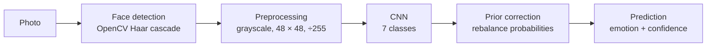
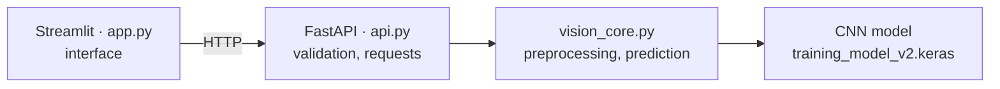

# Project Vision — Facial Emotion Recognition

An end-to-end computer vision project that classifies facial expressions with a convolutional neural network (CNN). The model is trained in Google Colab on FER+, and a bilingual web app lets users take or upload a photo to receive a prediction.

<p dir="rtl" lang="he">
<b>בעברית:</b> מערכת לזיהוי הבעות פנים באמצעות רשת נוירונים קונבולוציונית (<bdi>CNN</bdi>). המודל אומן על <bdi>FER+</bdi>, ואפליקציית רשת בעברית ובאנגלית מאפשרת לצלם או להעלות תמונה ולקבל חיזוי.
</p>

## At a glance

| Item | Details |
|---|---|
| **Task** | Facial-expression classification |
| **Emotions** | Angry, disgust, fear, happy, neutral, sad, surprise |
| **Dataset** | FER+ labels on FER-2013 images; contempt excluded, leaving 7 classes |
| **Model** | CNN with 3 convolution/pooling blocks, a 128-unit dense layer, and a 7-class softmax output |
| **Test accuracy** | **74.5%** on 7,042 FER+ test images (raw model output) |
| **Application** | FastAPI backend and Streamlit frontend |
| **Languages** | Hebrew and English |
| **Highlights** | Per-emotion probabilities, confidence threshold, and mobile-friendly interface |

## See it in action

<p align="center">
  
  &nbsp;&nbsp;
  
</p>

## How it works

The app detects a face, converts it to grayscale, resizes it to 48 × 48 pixels, scales pixel values to the range 0–1, and passes it to the CNN. The app applies a prior correction to the model probabilities, then displays the predicted emotion, confidence, and probabilities for all seven classes. Predictions below 60% confidence are marked as **Unknown**.



The application separates the interface from inference: Streamlit sends the image to FastAPI over HTTP, and the API loads the model once at startup.



## Model and evaluation

The project compares three versions using the same CNN architecture:

| Version | Training data / setting | Test accuracy | Outcome |
|---|---|---:|---|
| v1 | FER-2013 | ~59% | Initial model |
| **v2** | **FER+ (7 classes)** | **74.5%** | **Selected for the app** |
| v3 | FER+ with balanced class weights | 54% | Experiment; not selected |

FER+ improved the v2 result over v1. The app then applies a prior correction to v2's output to reduce the effect of class imbalance (`balance_prediction` in the notebook and in `vision_core.py`). On the test set, this changed accuracy from **74.5% to 73.8%** and macro recall from **52.4% to 60.2%**. The correction improves the balance of predictions for less common emotions; it does not retrain the model.

## Run locally

**Requirements:** Python 3.12. TensorFlow compatibility can depend on the Python version; use Python 3.12 for this project.

From the project directory, create and activate a virtual environment, then install the app dependencies:

```powershell
cd vision_app
py -3.12 -m venv .venv
.\.venv\Scripts\Activate.ps1
pip install -r requirements.txt
```

Start the API and frontend in separate terminals, both in `vision_app` with the virtual environment activated:

```powershell
uvicorn api:app --port 8000
```

```powershell
streamlit run app.py
```

Open [http://localhost:8501](http://localhost:8501). The frontend connects to the API at `http://localhost:8000`.

### Using the app

1. Take a photo or upload an image.
2. Select **Identify the emotion** to run the prediction.
3. Review the predicted emotion, confidence, and probabilities for all seven emotions.

If face detection does not find a face, the app analyzes the full image and displays a notice. Results are model predictions and should not be treated as a definitive assessment of a person's emotional state.

## Open the app on a phone

The camera is generally available to a mobile browser only on `localhost` or over HTTPS. For testing on a phone, you can expose the Streamlit frontend with ngrok:

1. Install ngrok and create an account at [ngrok.com](https://ngrok.com/).
2. Configure your ngrok authentication token locally:
   ```powershell
   ngrok config add-authtoken <YOUR_TOKEN>
   ```
3. With the API and Streamlit running, start a tunnel to the frontend:
   ```powershell
   ngrok http 8501
   ```
4. Open the HTTPS address printed by ngrok on your phone.

Only the Streamlit port is exposed by this setup; the API remains local. Keep the token private, and note the app is available only while the computer and required services are running.

**If the link doesn't open:**

| Error | Meaning | Fix |
|---|---|---|
| `ERR_NGROK_3200` | The endpoint is offline: no ngrok process is running | Start `ngrok http <port>` again (closing its terminal stops it) |
| `ERR_NGROK_121` | The ngrok agent is too old (free accounts need 3.20.0 or newer) | Run `ngrok update`, or download it again from [ngrok.com/download](https://ngrok.com/download) |

## Repository layout

| Path | What it is |
|---|---|
| `PROJECT_CNN.ipynb` | The Colab notebook: data, training, evaluation, and the inference functions |
| `JOURNAL.md` | The project journal: experiments, results, and what was learned |
| `screenshots/` | App screenshots (see [screenshots/README.md](screenshots/README.md)) |
| `vision_app/api.py` | FastAPI endpoints (`/health`, `/predict`) |
| `vision_app/app.py` | Streamlit interface |
| `vision_app/vision_core.py` | Model loading and the inference functions from the notebook |
| `vision_app/config.py` | Which model file the app loads |
| `vision_app/i18n.py` | Hebrew and English UI text |
| `vision_app/styles.py` | Interface styling |
| `vision_app/models/` | The model used by the app (`training_model_v2.keras`) |
| `vision_app/requirements.txt` | Python dependencies |

See [vision_app/README.md](vision_app/README.md) for the API reference and app-specific configuration details.

## Limitations

- The model uses 48 × 48 grayscale face images and may perform best on clear, frontal, well-lit faces.
- Fear and disgust are more difficult to recognize, in part because they have fewer training examples.
- Haar-cascade detection may miss small, tilted, or back-lit faces.
- Emotion classification is an estimate based on visual patterns; it does not establish how someone actually feels.

## Data and acknowledgments

- **FER-2013:** Goodfellow et al., “Challenges in Representation Learning,” ICML 2013. [Dataset on Kaggle](https://www.kaggle.com/datasets/msambare/fer2013).
- **FER+:** Barsoum et al., “Training Deep Networks for Facial Expression Recognition with Crowd-Sourced Label Distribution,” 2016. [Microsoft FER+ repository](https://github.com/microsoft/FERPlus).
- **Face detection:** OpenCV Haar cascade, `haarcascade_frontalface_default.xml`.

**Author:** Liran Martfel
